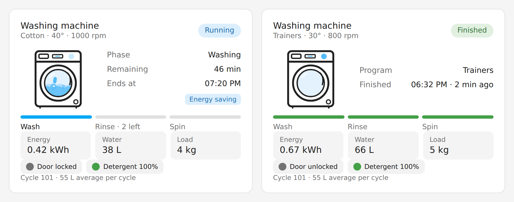
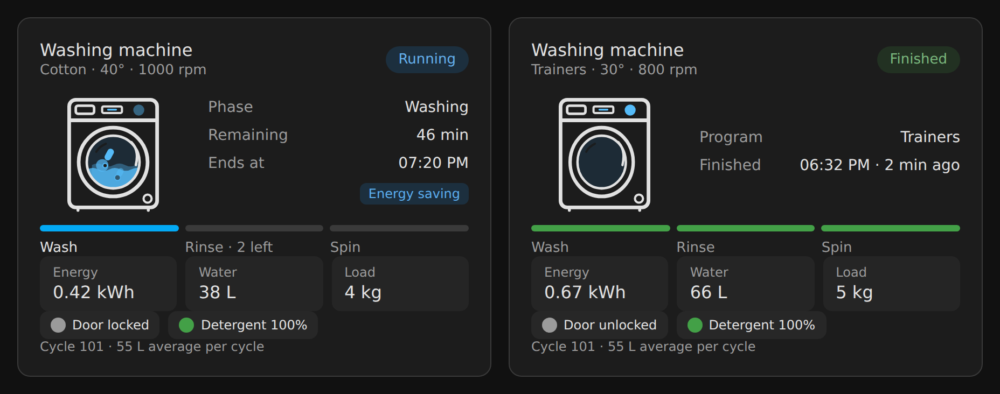

# hOn Washer Card

<p align="center"></p>

A Home Assistant dashboard card for hOn washing machines (Haier, Candy, Hoover): which step
the cycle is in, when it will end, the program and its settings, the energy and water it has
used, and the door lock, detergent and options.

It reads the entities created by the **[hOn integration by gvigroux](https://github.com/gvigroux/hon)**,
so install and set that up first. The card only shows; that integration has no controls to
start or stop a program.

## What it shows





Every state has its own animated icon.

| hOn mode | Card |
|---|---|
| Running, Ending | The current phase, three steps (Wash, Rinse, Spin) with the rinses left, time remaining, end time, energy, water and load |
| Paused | The same, with the step in amber |
| Scheduled | The program and when it starts |
| Finished | When it finished and how long ago, with the cycle's energy, water and load |
| Ready | No program, and whether the door is open |
| Error, or an error code other than `00` | "Error E2/E4/Unb" with what to check, over the step it was on |
| Disconnected | Machine off or offline |

The program line reads like the machine's: name, temperature and spin speed. Below the steps,
tags show the door lock, the detergent level (in orange at 10 % or less) and the child lock
when it's on, with each entity's own Home Assistant icon; tap one to open its details. Energy
saving, night wash and steam show when on. The footer has the cycle number and the average
water per cycle.

Some things about hOn the card works around:
- The machine reports **Finished** for only about two minutes, then goes back to Ready.
- The short spins **between rinses** (phase 3) count toward Rinse, so the steps never go
  backwards; only the final spin (phase 11) is Spin.
- A detergent level of 0 % that comes with a disconnection is ignored.

Animations stop when the system asks for reduced motion. Text is in English or Italian,
following your Home Assistant language.

<!-- ha-marketplace:exclude-start -->
## Install

[](https://my.home-assistant.io/redirect/marketplace_repository/?owner=enricodeleo&repository=hon-washer-card&category=plugin)

In Home Assistant 2026.11 or newer: **Settings → Marketplace → Add from link**, then enter
`enricodeleo/hon-washer-card`. Adding a link needs a one-time GitHub sign-in.

Manual install: copy `dist/hon-washer-card.js` to `/config/www/`, and add
`/local/hon-washer-card.js` as a JavaScript module resource.
<!-- ha-marketplace:exclude-end -->

## Configuration

Add it from the card picker ("hOn Washer Card"), or in YAML:

```yaml
type: custom:hon-washer-card
entity: sensor.washing_machine_mode
```

| Option | Required | Description |
|---|---|---|
| `entity` | yes | The hOn washing machine's mode sensor |
| `name` | no | Card title (default "Washing machine" / "Lavatrice") |
| `phase`, `program`, `error`, `remaining`, `start_time`, `end_time`, `temperature`, `spin_speed`, `rinses`, `weight`, `energy`, `water`, `door`, `door_lock`, `child_lock`, `detergent`, `energy_saving`, `night_wash`, `steam`, `cycle`, `mean_water` | no | Override an entity. By default they are found on the washing machine's device by the end of their entity id (`_program_phase`, `_remaining_time`, `_door_lock`, …). Set them only if that fails |

## Development

```bash
npm ci
npm run watch      # rebuilds dist/hon-washer-card.js on change
npm run typecheck
```

`dist/` is committed, so the Marketplace can install from the default branch. CI checks it
matches `src/`. To release:
1. Bump `version` in `package.json` and run `npm run build`.
2. Commit, then publish a GitHub release tagged `v<version>`.

The release workflow attaches the built file to the release.

## License

MIT. The washing machine artwork and state icons are part of this project.
